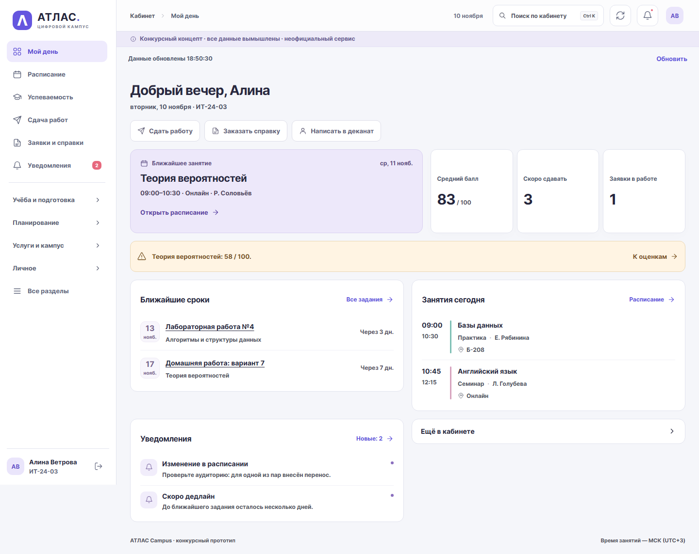

# АТЛАС Campus · цифровой деканат

Версия **3.2.1**, 10 ноября 2026. Работающий локальный конкурсный концепт: **все персонажи, оценки и документы вымышлены; сервис неофициальный**.



## Запуск

Для локального запуска нужны Python 3.13 или новее. Все данные демонстрационные и хранятся в локальной `atlas.db`; эта база намеренно не входит в репозиторий. Новый checkout создаст собственную базу с вымышленными записями. Не удаляйте существующую локальную базу при обновлении: миграции аддитивные.

### Windows

Откройте `Start-ATLAS.cmd`. Он подготовит виртуальное окружение `.venv`, установит runtime-зависимости при первом запуске, запустит сервер и откроет браузер. Адрес: http://127.0.0.1:8000. Остановка: Ctrl+C.

```powershell
# Первый запуск вручную:
powershell -ExecutionPolicy Bypass -File scripts/start.ps1 -Install
# Последующие запуски:
powershell -ExecutionPolicy Bypass -File scripts/start.ps1
```

### Linux и macOS

Запустите команды из корня проекта:

```sh
python3.13 -m venv .venv
. .venv/bin/activate
python -m pip install --upgrade pip==26.2.2
python -m pip install -r requirements.txt
APP_ENV=development DEMO_MODE=true python -m uvicorn app.main:app --host 127.0.0.1 --port 8000
```

Откройте http://127.0.0.1:8000 и остановите сервер сочетанием Ctrl+C.

### HTTPS и PostgreSQL

Для изолированного демонстрационного развёртывания нужны Docker Compose и домен, указывающий на сервер. Скопируйте `.env.example` в `.env`, задайте `DOMAIN` и сгенерируйте два разных случайных пароля для `POSTGRES_PASSWORD` и `ATLAS_APP_PASSWORD`. Шаблон содержит только инструкции и заглушки; `.env` исключён из Git. Запуск: `docker compose up --build -d`. Конфигурация требует HTTPS и PostgreSQL; подробности и ограничения описаны в [инструкции эксплуатации](docs/operations-preparation-2026-11-08.md). Для `DEMO_MODE=false` нет реальной регистрации пользователей или интеграции с вузом.

## Вымышленные тестовые аккаунты

Эти общедоступные учётные данные работают только с демонстрационными аккаунтами приложения. Не используйте их в других системах.

| Роль | Логин | Публичный вымышленный пароль |
|---|---|---|
| Алина | alina.demo | AtlasDemo!2026-A |
| Марк | mark.demo | AtlasDemo!2026-M |
| Кира, офис | dean.demo | AtlasStaff!2026-D |

## Исправления 3.2.1

[Реестр всех 34 находок двух аудитов](docs/audit-fixes-2026-11-10.md) содержит исправление, регрессионный тест и статус каждого ID. Полный pytest с настоящими Chromium-сценариями: **270 passed**, без ошибок и пропусков; два прежних предупреждения тестовых библиотек сохранены в отчёте.

- Отправка, восстановление и очистка черновика проверяют владельца и сеанс; сохранение ключа повтора обязательно до основной отправки. Смена аккаунта в другой вкладке проверяется и при скачивании файлов.
- Изменение личной записи связано с её постоянным токеном, а не только номером. Отметка задачи сохраняет остальные поля; конкурентные создания соблюдают предел 200, прежние записи сверх него остаются доступны.
- История имеет страницы, квитанции повторов больше не копируют растущий список сообщений. Исправлены даты, счётчики, пагинация, готовность БД, параллельные резервные копии и комплект исходного ZIP.
- Обновлены уязвимые инструменты проверки и PDF. Повторный аудит фактических Linux runtime и Windows dev/report окружений — в [машинных результатах](docs/verification/audit-fixes-2026-11-10/).

При первом запуске новой версии выполняется аддитивная миграция **0006**. Перед обновлением нужна резервная копия; удалять БД нельзя. Старые черновики `тип:номер` сохраняются отдельно, поскольку старый номер мог быть использован повторно. Их можно выгрузить через «Настройки → Мои черновики» и вручную перенести в нужную запись. [Миграции и совместимость](migrations/README.md).

## Что изменилось в 3.2 (9 ноября)

- Ближайшая пара и календарь открывают конкретную запись с датой/контекстом. Учебный риск ведёт к подходящей дисциплине; если слота нет, доступны материалы, работа или вопрос офису.
- Личная отметка задания явно отделена от отправки работы и оценки. Сохранены 27 студенческих разделов, 5 служебных разделов и 22 услуги.
- Черновики долгих форм сохраняются на сервере только для владельца. Доступны 14 дней; просроченные удаляются при следующем сохранении. Потеря сеанса не показывает ввод другому аккаунту. Ключ безопасной отправки сохраняется до подтверждения результата.
- Темы, сообщения и важные операции защищены от повторного создания. Общие квоты записи переживают процессы; в публичном режиме они строже локальных тестовых лимитов.
- Библиотечный поиск фильтрует до LIMIT, списки имеют страницы, будущие события не скрываются архивом. Устранён рост числа SQL-запросов на курсах и заданиях.
- Справка, выписка и пересдача имеют подходящие поля. Сотрудник может запросить уточнение; студент дополняет историю или просит отозвать. Статус меняет сотрудник по допустимым переходам.
- Видны состояние связи и время обновления. Ошибки относятся к конкретным полям, показатели объяснены, подпись расписания исправлена на 360 px. Статика сжимается при передаче.
- Версия API и исходников единая, доступен идентификатор сборки. Демодаты продлены без сброса истории до 30 ноября.

## Проверки и материалы

[Фактическая приёмка](docs/release-checklist.md), [статус всех 70 улучшений и оценка](docs/improvements-3.2-status.md), [процесс](docs/process.md), [подлинные промпты/итерации](docs/ai-evidence-3.2.md), [руководство жюри](docs/jury-guide.md).

Текущие JSON и JUnit: `docs/verification/audit-fixes-2026-11-10/`. Снимки до/после: `screenshots/audit-fixes-2026-11-10/`. Материалы версии 3.2 от 9 ноября сохранены в `docs/verification/improvements-2026-11-08/` и `screenshots/improvements-2026-11-09/`, включая ролик `demo/atlas-demo-local.mp4`. Это настоящие автоматизированные локальные проходы, не исследование людей.

```powershell
.venv/Scripts/python.exe -m pip install pip==26.2.2
.venv/Scripts/python.exe -m pip install -r requirements-dev.txt -r docs/requirements-report.txt
.venv/Scripts/python.exe -m playwright install chromium firefox webkit
npm ci --ignore-scripts
$env:ATLAS_RUN_BROWSER_TESTS='1'
.venv/Scripts/python.exe -m pytest -q tests/
node --check static/app.js
node --check static/campus.js
node --check static/improvements.js
.venv/Scripts/python.exe scripts/improvement_ui_capture.py after
.venv/Scripts/python.exe scripts/improvement_crossbrowser.py
.venv/Scripts/python.exe scripts/improvement_load.py
.venv/Scripts/python.exe scripts/improvement_performance.py
.venv/Scripts/python.exe scripts/improvement_deployment.py
```

Нужны dev-зависимости, Playwright Chromium/Firefox/WebKit, `npm ci --ignore-scripts`; для последней команды — Docker Engine. Все проверки используют отдельные вымышленные БД. [Адаптация к другому фиктивному факультету](docs/adaptation.md) проверяется отдельным скриптом.

Подготовлены [протокол исследования](docs/research-kit/protocol.md) и [ручная приёмка](docs/manual-acceptance-3.2.md). Реальные интервью, физические телефоны, ручной скринридер и подключение из РФ не заявляются. Для конкурса владельцу нужны постоянный адрес, размещение до 28 ноября и доступные жюри ссылки. Официальные логотипы вузов и реальные системы не используются. [Лицензии](docs/third-party.md).
