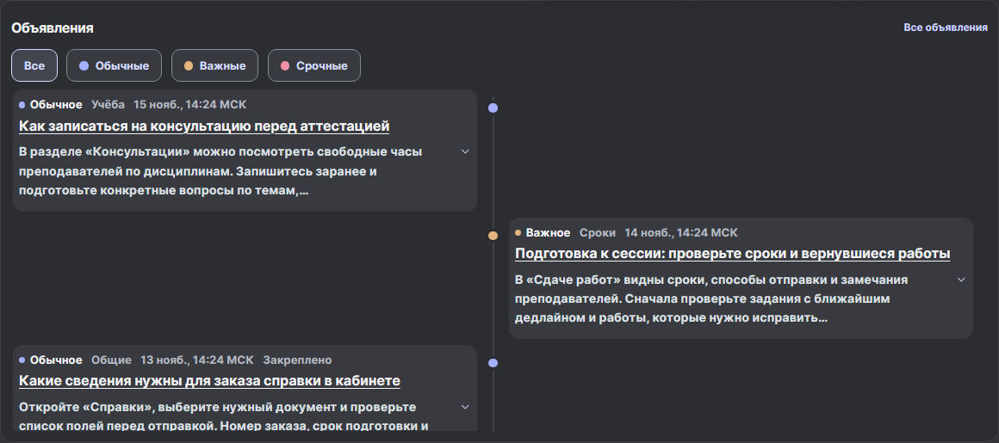

# АТЛАС Campus · цифровой деканат

Версия исходников **3.7.0**. [Сайт АТЛАС](https://atlas-university.ru/), [приёмка релизов](docs/release-checklist.md) и [руководство по кабинету](docs/workflow-guide.md).



Для конкурсной проверки 23–28 ноября подготовлена связанная синтетическая история осеннего семестра 2026/2027. Команда `python -m app.contest` заполняет отдельную пустую БД. [Сценарии, покрытие и переключение стенда](docs/contest-dataset-2026.md).

## Успеваемость и посещаемость

В «Начисленных баллах» видны проверенные работы, баллы за занятия, максимумы, итоги по дисциплинам и история корректировок. Таблица посещаемости показывает каждое проведённое или отменённое занятие опубликованного семестра. Обе таблицы поддерживают поиск, фильтры, сортировку и группировку.

Рядом с пропуском студент может отправить PDF или фотографию. Один документ можно привязать сразу к нескольким пропускам. Преподаватель получает уведомление и принимает решение в «Справках о пропусках». Подтверждение сохраняет факт отсутствия и исключает пропуск из числа неуважительных. В публичных демо-аккаунтах доступна таблица посещаемости. Для отправки, просмотра и рассмотрения справок нужен личный аккаунт. [Контракты, сроки хранения и права](docs/academic-records.md) · [Снимки](screenshots/academics-stage-6/README.md).

## Сдача работ

Задания преподавателей собраны по дисциплинам. Студент видит ближайшие сроки по Москве, состояние проверки, работу на доработке и выставленные баллы. Форма открывает поля, которые разрешил преподаватель. Черновик и выбранные файлы восстанавливаются в том же браузере. Ответы и отзывы сохраняются по версиям.

Преподаватель выдаёт работы группе, подгруппе или отдельным студентам, добавляет исходники и задаёт общий, индивидуальный срок или срок пересдачи. При проверке можно сравнить попытки, приложить исправления, принять работу и выставить балл. Корректировка оценки сохраняет исходное начисление, новый балл и причину. [Порядок работы и API](docs/assignment-workflow.md) · [Снимки до и после](screenshots/assignments-stage-5/README.md).

## Расписание и учебный календарь

Студент видит день, неделю или месяц. Лекции, практики, лабораторные и специальные события обозначены текстом и цветом. Сроки сдачи видны отдельными отметками. У перенесённых и отменённых занятий можно раскрыть подробности, а предупреждение о просмотренных изменениях можно скрыть. Расписание выгружается в ICS.

В разделе «Организация занятий» сотрудники готовят и утверждают события и переносы. Администратор задаёт семестры, учебные недели и исключения для вуза, программы или группы и управляет подгруппами. [Настройка календаря и правила публикации](docs/schedule.md) · [Снимки до и после](screenshots/schedule-stage-3/README.md).

## Навигация кабинета

Боковое меню раскрывает одно направление за раз. На компьютере оно сворачивается до иконок, а на телефоне открывается кнопкой меню. Ссылки на соседние страницы доступны над содержимым. Прежние адреса обзоров открывают первый рабочий подраздел. В настройках всех ролей можно включить «Компактный вид».

В «Настройки → Вид и уведомления» выберите светлую, серую тёмную или системную тему. По умолчанию оформление следует настройкам устройства. Выбор сохраняется в текущем браузере. В обычном и компактном видах уменьшены отступы карточек, списков и диалоговых окон. [Снимки интерфейса до и после](screenshots/ui-stage-1-2026-11-15/README.md).

В таймлайне на главной нажмите на текст длинного анонса, чтобы раскрыть или свернуть его. Заголовок открывает полную публикацию. Учебный офис управляет публикациями и аудиторией. Значок в верхней панели показывает непрочитанные события. [Контракты объявлений и уведомлений](docs/api-contracts.md).

«Заявки» показывают обращения, а «Справки» — заказ и получение документов. Учебный офис использует ту же историю обработки с отдельными очередями. Готовый результат можно скачать из карточки справки. На странице входа кнопка «Или выбрать демо-аккаунт» открывает список аккаунтов по ролям. [Каталог и основания выдачи справок](docs/certificates.md).

## Учебные материалы и личные сообщения

В разделе «Учебные материалы и задания» откройте «Мои дисциплины», чтобы просмотреть предметы, модули и учебные материалы. Из карточки предмета можно перейти к его работам. [Изменения навигации и прежние адреса](docs/release-checklist.md) · [Снимки этапа 2](screenshots/ui-stage-2-2026-11-15/README.md).

В «Университете» откройте Институт цифровых технологий → Кафедру
информационных систем → Михаила Орлова. В профиле есть дисциплина,
еженедельные занятия, консультации и лекция о поиске пути в графе.
Лекцию можно прочитать в кабинете и скачать в виде автономного HTML.
Там же откройте «Написать преподавателю». В другом профиле браузера
войдите как Михаил Орлов, откройте «Личные сообщения» и ответьте.
Получатель увидит уведомление со ссылкой на переписку. На компьютере список диалогов и переписка находятся рядом, на телефоне открываются отдельными экранами.
Поиск диалогов и адресатов обновляет список с первого символа. Очистка поля возвращает полный список, а после ошибки поиск можно повторить в той же форме.
После отправки ответа история обновляется в открытом диалоге, а поле ввода сохраняет фокус и текст, набранный во время отправки.
На телефоне прокрутку можно начать прямо над сообщением. При открытии клавиатуры форма входа и поле сообщения подстраиваются под видимую часть экрана.

## Мои дисциплины и публикации

На странице дисциплины сразу открываются материалы. Их можно отфильтровать по типу, найти по названию, автору, описанию или тексту и отсортировать по дате добавления, обновления или названию. В соседних вкладках студент видит преподавателей, учебные модули, занятия, задания, консультации и объявления.

В «Публикациях» преподаватель добавляет текст, HTTPS-ссылку или файл до 5 МиБ, выбирает аудиторию и при необходимости заменяет вложение. Архив сохраняет запись, файл и историю с автором и временем изменений. Из карточки преподавателя можно открыть дисциплину, отфильтровать его материалы или перейти к конкретной публикации. Привязанные к заданию материалы открываются по тем же ссылкам.

Учебный офис управляет публикациями кампуса. Администратор выдаёт и отзывает полномочия ответственному за курс или сотруднику кафедры. Сервер проверяет назначение при сохранении, чтении и скачивании.
[Маршруты, API и права](docs/university-api.md).

## Преподаватель и управление учебным процессом

Преподаватель ведёт закреплённые группы и дисциплины, начисляет баллы
и отмечает посещаемость. В «Сессии и зачётах» видны
подтверждённые сведения об аттестации и доступные действия.

Кабинет преподавателя показывает работы на проверке, закреплённые группы, ближайшие занятия и консультации. Из него можно открыть ведомость, отметить посещаемость, назначить задание и принять работу или вернуть её с замечаниями. Студент отправляет новую версию после доработки и видит предыдущий ответ. Документ, отправленный преподавателю через личный диалог, могут скачать оба участника. Заказ документов и официальные заявки обрабатывает учебный офис.
[Как назначить, сдать и проверить работу](docs/assignment-workflow.md).

[Снимки до и после объединения дисциплин и материалов](screenshots/discipline-stage-4/README.md).

Диспетчер готовит занятия, серии и переносы. Деканат согласует проект.
Администратор утверждает его и ведёт группы, состав и нагрузку.
Проверяются пересечения по аудитории, группе и преподавателю,
вместимость, оборудование и доступность. Табличный обмен поддерживает
CSV и XLSX, шаблоны, сопоставление столбцов, ошибки строк и транзакционный
импорт. [Матрица прав, сценарии и ограничения](docs/academic-workspace.md).

## Профсоюз и ВУЦ

Студент оформляет вступление и выход, обращается за консультацией или
помощью, записывается на мероприятия. Представитель профсоюза
рассматривает заявления и публикует информацию.

ВУЦ показывает программы подготовки офицеров, сержантов и солдат запаса
по модели НИУ МГСУ. Кампания привязана к программе и учебному году.
Студент проверяет сроки и документы, создаёт обращение и получает сообщения
о следующих шагах. Сотрудник ВУЦ публикует кампании и объявления, регистрирует
подачу документов, решения комиссии и допуск по реквизитам документов.
Действия сохраняются с автором и временем. Завершённые кампании доступны
в архиве. [Порядок приёма, источники и полномочия](docs/vuc-admission.md) · [Снимки этапа 7](screenshots/vuc-stage-7-2026-11-22/README.md).

Общие сведения о профсоюзе и прежней структуре подразделений описаны
в [документации первого выпуска](docs/union-vuc-implementation.md).

[Локальная приёмка 3.5.0](docs/release-checklist.md).
[Итоговый отчёт и доступы для ручной приёмки](docs/final-local-acceptance.md).

## Запуск

Для локального запуска нужен Python 3.13 или новее. При первом запуске создаётся локальная `atlas.db`. Сохраните существующую базу при обновлении. Приложение применит миграции на месте.

### Windows

Откройте `Start-ATLAS.cmd`. Он подготовит виртуальное окружение `.venv`, установит runtime-зависимости при первом запуске, запустит сервер и откроет браузер. Адрес: http://127.0.0.1:8000. Остановка: Ctrl+C.

```powershell
# Первый запуск вручную:
powershell -ExecutionPolicy Bypass -File scripts/start.ps1 -Install
# Последующие запуски:
powershell -ExecutionPolicy Bypass -File scripts/start.ps1
```

Для отдельной базы можно передать `-DatabasePath` с путём к файлу
SQLite в существующей папке. Стенд ручной приёмки использует этот
параметр. [Адрес и вход](docs/final-local-acceptance.md).

### Linux и macOS

Запустите команды из корня проекта:

```sh
python3.13 -m venv .venv
. .venv/bin/activate
python -m pip install --upgrade pip==26.2.2
python -m pip install -r requirements.txt
APP_ENV=development DEMO_MODE=true python -m uvicorn app.main:app --host 127.0.0.1 --port 8000
```

Откройте http://127.0.0.1:8000 и остановите сервер сочетанием Ctrl+C.

### HTTPS и PostgreSQL

Публичный VPS использует Docker Compose, Caddy, PostgreSQL, мониторинг и автоматическое резервное копирование. Для новой установки следуйте [инструкции развёртывания](docs/deployment.md). Устройство сервера описано в [отчёте о приёмке](docs/production-acceptance-2026-11-11.md). Настраивайте окружение по `.env.example` и храните приватный `.env` вне Git.

## Аккаунты для входа

При `DEMO_MODE=true` эти общедоступные аккаунты можно выбрать по роли на странице входа.

| Роль | Логин | Общедоступный пароль |
|---|---|---|
| Алина | alina.demo | AtlasDemo!2026-A |
| Марк | mark.demo | AtlasDemo!2026-M |
| Кира, офис | dean.demo | AtlasStaff!2026-D |
| Михаил, преподаватель | orlov.demo | AtlasTeach!2026-M |
| Елена, преподаватель | ryabinina.demo | AtlasTeach!2026-E |
| Нина, преподаватель | lastochkina.demo | AtlasTeach!2026-N |
| Даниил, преподаватель | zorin.demo | AtlasTeach!2026-Z |
| София, диспетчер | schedule.demo | AtlasRooms!2026-S |
| Роман, администратор | registry.demo | AtlasRegistry!2026-R |
| Полина, профсоюз | union.demo | AtlasUnion!2026-U |
| Артём, ВУЦ | vuc.demo | AtlasCenter!2026-V |

## Исправления 3.2.1

[Реестр всех 34 находок двух аудитов](docs/audit-fixes-2026-11-10.md) содержит исправление, регрессионный тест и статус каждого ID. Полный pytest с настоящими Chromium-сценариями: **270 passed**, без ошибок и пропусков; два прежних предупреждения тестовых библиотек сохранены в отчёте.

- Отправка, восстановление и очистка черновика проверяют владельца и сеанс; сохранение ключа повтора обязательно до основной отправки. Смена аккаунта в другой вкладке проверяется и при скачивании файлов.
- Изменение личной записи связано с её постоянным токеном, а не только номером. Отметка задачи сохраняет остальные поля; конкурентные создания соблюдают предел 200, прежние записи сверх него остаются доступны.
- История имеет страницы, квитанции повторов больше не копируют растущий список сообщений. Исправлены даты, счётчики, пагинация, готовность БД, параллельные резервные копии и комплект исходного ZIP.
- Обновлены уязвимые инструменты проверки и PDF. Повторный аудит фактических Linux runtime и Windows dev/report окружений — в [машинных результатах](docs/verification/audit-fixes-2026-11-10/).

Перед обновлением сохраните резервную копию БД. Приложение применяет
отсутствующие миграции при запуске. Сохранённые черновики продолжают
восстанавливаться в поддерживаемых формах.
[Миграции и совместимость](migrations/README.md).

## Что изменилось в 3.2 (9 ноября)

- Ближайшая пара и календарь открывают конкретную запись с датой/контекстом. Учебный риск ведёт к подходящей дисциплине; если слота нет, доступны материалы, работа или вопрос офису.
- Личная отметка задания явно отделена от отправки работы и оценки. Сохранены 27 студенческих разделов, 5 служебных разделов и 22 услуги.
- Черновики долгих форм сохраняются на сервере только для владельца. Доступны 14 дней; просроченные удаляются при следующем сохранении. Потеря сеанса не показывает ввод другому аккаунту. Ключ безопасной отправки сохраняется до подтверждения результата.
- Темы, сообщения и важные операции защищены от повторного создания. Общие квоты записи переживают процессы; в публичном режиме они строже локальных тестовых лимитов.
- Библиотечный поиск фильтрует до LIMIT, списки имеют страницы, будущие события не скрываются архивом. Устранён рост числа SQL-запросов на курсах и заданиях.
- Справка, выписка и пересдача имеют подходящие поля. Сотрудник может запросить уточнение; студент дополняет историю или просит отозвать. Статус меняет сотрудник по допустимым переходам.
- Видны состояние связи и время обновления. Ошибки относятся к конкретным полям, показатели объяснены, подпись расписания исправлена на 360 px. Статика сжимается при передаче.
- Версия API и исходников единая, доступен идентификатор сборки. Календарь дополнен занятиями и событиями до 30 ноября с сохранением истории.

## Проверки и материалы

GitHub Actions запускает [Acceptance](.github/workflows/checks.yml): тесты и браузерные сценарии, аудит зависимостей, PostgreSQL/HTTPS и расширенные проверки. Внешние actions закреплены полными 40-символьными SHA; сокращённые SHA не поддерживаются при подготовке задания.

Тест упаковки исходного ZIP проверяет включение скрытого `.env.example` на Windows/Linux и исключение остальных `.env`-файлов из архива.

Браузерный сценарий «Прочитать все» ожидает успешный ответ сервера и завершение обновления страницы перед проверкой сохранённого счётчика уведомлений. Проверка валидации формы начинает ввод после завершения восстановления прежнего черновика.

[Фактическая приёмка](docs/release-checklist.md), [реестр 70 улучшений](docs/improvements-3.2-status.md), [процесс](docs/process.md), [подлинные промпты/итерации](docs/ai-evidence-3.2.md), [руководство по кабинету](docs/workflow-guide.md).

Текущие JSON и JUnit: `docs/verification/audit-fixes-2026-11-10/`. Снимки до/после: `screenshots/audit-fixes-2026-11-10/`. Материалы версии 3.2 от 9 ноября сохранены в `docs/verification/improvements-2026-11-08/` и `screenshots/improvements-2026-11-09/`, включая ролик `demo/atlas-demo-local.mp4`. Это настоящие автоматизированные локальные проходы, не исследование людей.

```powershell
.venv/Scripts/python.exe -m pip install pip==26.2.2
.venv/Scripts/python.exe -m pip install -r requirements-dev.txt -r docs/requirements-report.txt
.venv/Scripts/python.exe -m playwright install chromium firefox webkit
npm ci --ignore-scripts
$env:ATLAS_RUN_BROWSER_TESTS='1'
.venv/Scripts/python.exe -m pytest -q tests/
node --check static/app.js
node --check static/campus.js
node --check static/improvements.js
node --check static/university.js
node --check static/operations.js
node --check static/units.js
node --check static/vuc.js
.venv/Scripts/python.exe scripts/navigation_check.py complete --engines chromium,firefox,webkit --screenshots screenshots/navigation-2026-11-11 --report docs/verification/navigation-2026-11-11/complete-ui.json
.venv/Scripts/python.exe scripts/workspace_ui.py units --engines chromium,firefox,webkit --screenshots screenshots/workspace-2026-11-11 --report docs/verification/workspace-2026-11-11/final-ui.json
.venv/Scripts/python.exe scripts/improvement_ui_capture.py after
.venv/Scripts/python.exe scripts/improvement_crossbrowser.py
.venv/Scripts/python.exe scripts/improvement_load.py
.venv/Scripts/python.exe scripts/improvement_performance.py
.venv/Scripts/python.exe scripts/improvement_deployment.py
```

Нужны dev-зависимости, Playwright Chromium/Firefox/WebKit, `npm ci --ignore-scripts`; для последней команды — Docker Engine. Сценарии с записью используют отдельные базы. [Адаптация к другой структуре факультета](docs/adaptation.md) проверяется отдельным скриптом.

Сетевые HTTPS-пробы из России относятся к публичной приёмке версии
3.2.1. Локальная проверка 3.5.0 использует изолированную базу и
эмуляцию ширин. Реальные интервью, физические телефоны и ручной
скринридер остаются отдельными этапами. [Протокол исследования](docs/research-kit/protocol.md),
[ручная приёмка](docs/manual-acceptance-3.2.md), [лицензии](docs/third-party.md).
