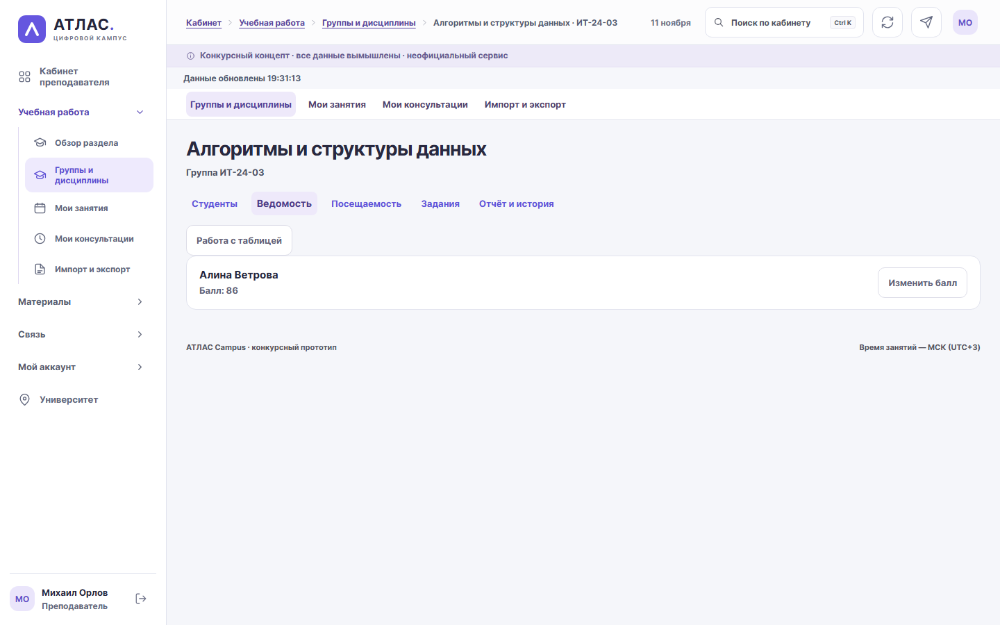

# АТЛАС Campus · цифровой деканат

Версия исходников **3.6.0**. Все персонажи, оценки и документы вымышлены. АТЛАС — неофициальный конкурсный концепт. [Публичный стенд](https://atlas-university.ru/), [приёмка релизов](docs/release-checklist.md) и [инструкция жюри](docs/jury-guide.md).



## Навигация кабинета

Боковое меню раскрывает одно направление за раз. На компьютере оно сворачивается до иконок, а на телефоне открывается кнопкой меню. Ссылки на соседние страницы доступны над содержимым. Прежние адреса обзоров открывают первый рабочий подраздел. В настройках всех ролей можно включить «Компактный вид».

В «Настройки → Вид и уведомления» выберите светлую, тёмную или системную тему. По умолчанию используется системная тема, которая сразу реагирует на изменение настроек устройства. Выбор сохраняется в текущем браузере и применяется при следующем входе. [Аудит оформления и снимки до и после](docs/theme-audit-2026-11-13.md).

На главной независимые колонки виджетов и таймлайн объявлений. Учебный офис управляет публикациями и аудиторией в разделе объявлений. Уведомления доступны во всех кабинетах, а значок в верхней панели показывает непрочитанные события. [Контракты объявлений и уведомлений](docs/api-contracts.md).

«Заявки» показывают обращения, а «Справки» — заказ и получение документов. Учебный офис использует ту же историю обработки с отдельными очередями. Готовый результат можно скачать из карточки справки. На странице входа «Попробовать демо» открывает компактный выбор аккаунта по роли. [Каталог и основания выдачи справок](docs/certificates.md).

## Учебные материалы и личные сообщения

В «Университете» откройте Институт цифровых технологий → Кафедру
информационных систем → Михаила Орлова. В профиле есть дисциплина,
еженедельные занятия, консультации и лекция о поиске пути в графе.
Лекцию можно прочитать в кабинете и скачать в виде автономного HTML.
Там же откройте «Написать преподавателю». В другом профиле браузера
войдите как Михаил Орлов, откройте «Личные сообщения» и ответьте.
Получатель увидит уведомление со ссылкой на переписку. На компьютере список диалогов и переписка находятся рядом, на телефоне открываются отдельными экранами.
После отправки ответа история обновляется в открытом диалоге, а поле ввода сохраняет фокус и текст, набранный во время отправки.
На телефоне прокрутку можно начать прямо над сообщением. При открытии клавиатуры форма входа и поле сообщения подстраиваются под видимую часть экрана.

Учебный офис управляет всеми публикациями. Преподаватель публикует,
редактирует и удаляет материалы по своим дисциплинам. Содержимое хранится
в базе. Редактор формирует HTML из текста с разделами или слайдами.
Прежний библиотечный формуляр находится в «Обучение → Библиотека».
[Маршруты, API и права](docs/university-api.md).

## Преподаватель и управление учебным процессом

Михаил Орлов ведёт закреплённые группы и дисциплины, изменяет баллы и
посещаемость с историей, публикует задания, проверяет версии работ,
оставляет обратную связь и назначает консультации. Файлы TXT и MD можно
загрузить в редактор учебного материала. Личная переписка связывает
студента с преподавателем.

Диспетчер готовит занятия, серии и переносы. Деканат согласует проект.
Администратор утверждает его и ведёт группы, состав и нагрузку.
Проверяются пересечения по аудитории, группе и преподавателю,
вместимость, оборудование и доступность. Табличный обмен поддерживает
CSV и XLSX, шаблоны, сопоставление столбцов, ошибки строк и транзакционный
импорт. [Матрица прав, сценарии и ограничения](docs/academic-workspace.md).

## Профсоюз и ВУЦ

Студент оформляет вступление и выход, обращается за консультацией или
помощью, записывается на мероприятия. Представитель профсоюза
рассматривает заявления и публикует информацию.

ВУЦ показывает учебные программы и сроки приёма. Студент подаёт заявку
с двумя демонстрационными флажками. Сотрудник проводит её по этапам,
назначает группу, ведёт календарь и результаты. Решения сохраняются
в истории и приходят в уведомления. У подразделений отдельные роли,
очереди, документы, журналы и выгрузки. [Предварительное исследование](docs/union-vuc-research.md),
[реализация и права](docs/union-vuc-implementation.md).

[Локальная приёмка 3.5.0](docs/release-checklist.md).
[Итоговый отчёт и доступы для ручной приёмки](docs/final-local-acceptance.md).

## Запуск

Для локального запуска нужны Python 3.13 или новее. Все данные демонстрационные и хранятся в локальной `atlas.db`; эта база намеренно не входит в репозиторий. Новый checkout создаст собственную базу с вымышленными записями. Не удаляйте существующую локальную базу при обновлении: миграции аддитивные.

### Windows

Откройте `Start-ATLAS.cmd`. Он подготовит виртуальное окружение `.venv`, установит runtime-зависимости при первом запуске, запустит сервер и откроет браузер. Адрес: http://127.0.0.1:8000. Остановка: Ctrl+C.

```powershell
# Первый запуск вручную:
powershell -ExecutionPolicy Bypass -File scripts/start.ps1 -Install
# Последующие запуски:
powershell -ExecutionPolicy Bypass -File scripts/start.ps1
```

Для отдельной базы можно передать `-DatabasePath` с путём к файлу
SQLite в существующей папке. Стенд ручной приёмки использует этот
параметр. [Адрес и вход](docs/final-local-acceptance.md).

### Linux и macOS

Запустите команды из корня проекта:

```sh
python3.13 -m venv .venv
. .venv/bin/activate
python -m pip install --upgrade pip==26.2.2
python -m pip install -r requirements.txt
APP_ENV=development DEMO_MODE=true python -m uvicorn app.main:app --host 127.0.0.1 --port 8000
```

Откройте http://127.0.0.1:8000 и остановите сервер сочетанием Ctrl+C.

### HTTPS и PostgreSQL

Публичный VPS использует Docker Compose, Caddy, PostgreSQL и автоматические проверки/резервное копирование. Для новой установки следуйте [инструкции развёртывания](docs/deployment.md); работающий сервер описан в [приёмке](docs/production-acceptance-2026-11-11.md). `.env.example` содержит только заглушки; приватный `.env` исключён из Git. Для `DEMO_MODE=false` нет реальной регистрации пользователей или интеграции с вузом.

## Вымышленные тестовые аккаунты

Эти общедоступные учётные данные работают только с демонстрационными аккаунтами приложения. Не используйте их в других системах.

| Роль | Логин | Публичный вымышленный пароль |
|---|---|---|
| Алина | alina.demo | AtlasDemo!2026-A |
| Марк | mark.demo | AtlasDemo!2026-M |
| Кира, офис | dean.demo | AtlasStaff!2026-D |
| Михаил, преподаватель | orlov.demo | AtlasTeach!2026-M |
| Елена, преподаватель | ryabinina.demo | AtlasTeach!2026-E |
| Нина, преподаватель | lastochkina.demo | AtlasTeach!2026-N |
| Даниил, преподаватель | zorin.demo | AtlasTeach!2026-Z |
| София, диспетчер | schedule.demo | AtlasRooms!2026-S |
| Роман, администратор | registry.demo | AtlasRegistry!2026-R |
| Полина, профсоюз | union.demo | AtlasUnion!2026-U |
| Артём, ВУЦ | vuc.demo | AtlasCenter!2026-V |

## Исправления 3.2.1

[Реестр всех 34 находок двух аудитов](docs/audit-fixes-2026-11-10.md) содержит исправление, регрессионный тест и статус каждого ID. Полный pytest с настоящими Chromium-сценариями: **270 passed**, без ошибок и пропусков; два прежних предупреждения тестовых библиотек сохранены в отчёте.

- Отправка, восстановление и очистка черновика проверяют владельца и сеанс; сохранение ключа повтора обязательно до основной отправки. Смена аккаунта в другой вкладке проверяется и при скачивании файлов.
- Изменение личной записи связано с её постоянным токеном, а не только номером. Отметка задачи сохраняет остальные поля; конкурентные создания соблюдают предел 200, прежние записи сверх него остаются доступны.
- История имеет страницы, квитанции повторов больше не копируют растущий список сообщений. Исправлены даты, счётчики, пагинация, готовность БД, параллельные резервные копии и комплект исходного ZIP.
- Обновлены уязвимые инструменты проверки и PDF. Повторный аудит фактических Linux runtime и Windows dev/report окружений — в [машинных результатах](docs/verification/audit-fixes-2026-11-10/).

При первом запуске версии 3.6.0 применяются отсутствующие миграции до **0012**. Сохраните резервную копию БД перед обновлением. Сохранённые черновики продолжают восстанавливаться в поддерживаемых формах.
[Миграции и совместимость](migrations/README.md).

## Что изменилось в 3.2 (9 ноября)

- Ближайшая пара и календарь открывают конкретную запись с датой/контекстом. Учебный риск ведёт к подходящей дисциплине; если слота нет, доступны материалы, работа или вопрос офису.
- Личная отметка задания явно отделена от отправки работы и оценки. Сохранены 27 студенческих разделов, 5 служебных разделов и 22 услуги.
- Черновики долгих форм сохраняются на сервере только для владельца. Доступны 14 дней; просроченные удаляются при следующем сохранении. Потеря сеанса не показывает ввод другому аккаунту. Ключ безопасной отправки сохраняется до подтверждения результата.
- Темы, сообщения и важные операции защищены от повторного создания. Общие квоты записи переживают процессы; в публичном режиме они строже локальных тестовых лимитов.
- Библиотечный поиск фильтрует до LIMIT, списки имеют страницы, будущие события не скрываются архивом. Устранён рост числа SQL-запросов на курсах и заданиях.
- Справка, выписка и пересдача имеют подходящие поля. Сотрудник может запросить уточнение; студент дополняет историю или просит отозвать. Статус меняет сотрудник по допустимым переходам.
- Видны состояние связи и время обновления. Ошибки относятся к конкретным полям, показатели объяснены, подпись расписания исправлена на 360 px. Статика сжимается при передаче.
- Версия API и исходников единая, доступен идентификатор сборки. Демодаты продлены без сброса истории до 30 ноября.

## Проверки и материалы

GitHub Actions запускает [Acceptance](.github/workflows/checks.yml): тесты и браузерные сценарии, аудит зависимостей, PostgreSQL/HTTPS и расширенные проверки. Внешние actions закреплены полными 40-символьными SHA; сокращённые SHA не поддерживаются при подготовке задания.

Тест упаковки исходного ZIP проверяет включение скрытого `.env.example` на Windows/Linux и исключение остальных `.env`-файлов из архива.

Браузерный сценарий «Прочитать все» ожидает успешный ответ сервера и завершение обновления страницы перед проверкой сохранённого счётчика уведомлений. Проверка валидации формы начинает ввод после завершения восстановления прежнего черновика.

[Фактическая приёмка](docs/release-checklist.md), [статус всех 70 улучшений и оценка](docs/improvements-3.2-status.md), [процесс](docs/process.md), [подлинные промпты/итерации](docs/ai-evidence-3.2.md), [руководство жюри](docs/jury-guide.md).

Текущие JSON и JUnit: `docs/verification/audit-fixes-2026-11-10/`. Снимки до/после: `screenshots/audit-fixes-2026-11-10/`. Материалы версии 3.2 от 9 ноября сохранены в `docs/verification/improvements-2026-11-08/` и `screenshots/improvements-2026-11-09/`, включая ролик `demo/atlas-demo-local.mp4`. Это настоящие автоматизированные локальные проходы, не исследование людей.

```powershell
.venv/Scripts/python.exe -m pip install pip==26.2.2
.venv/Scripts/python.exe -m pip install -r requirements-dev.txt -r docs/requirements-report.txt
.venv/Scripts/python.exe -m playwright install chromium firefox webkit
npm ci --ignore-scripts
$env:ATLAS_RUN_BROWSER_TESTS='1'
.venv/Scripts/python.exe -m pytest -q tests/
node --check static/app.js
node --check static/campus.js
node --check static/improvements.js
node --check static/university.js
node --check static/operations.js
node --check static/units.js
.venv/Scripts/python.exe scripts/navigation_check.py complete --engines chromium,firefox,webkit --screenshots screenshots/navigation-2026-11-11 --report docs/verification/navigation-2026-11-11/complete-ui.json
.venv/Scripts/python.exe scripts/workspace_ui.py units --engines chromium,firefox,webkit --screenshots screenshots/workspace-2026-11-11 --report docs/verification/workspace-2026-11-11/final-ui.json
.venv/Scripts/python.exe scripts/improvement_ui_capture.py after
.venv/Scripts/python.exe scripts/improvement_crossbrowser.py
.venv/Scripts/python.exe scripts/improvement_load.py
.venv/Scripts/python.exe scripts/improvement_performance.py
.venv/Scripts/python.exe scripts/improvement_deployment.py
```

Нужны dev-зависимости, Playwright Chromium/Firefox/WebKit, `npm ci --ignore-scripts`; для последней команды — Docker Engine. Все проверки используют отдельные вымышленные БД. [Адаптация к другому фиктивному факультету](docs/adaptation.md) проверяется отдельным скриптом.

Сетевые HTTPS-пробы из России относятся к публичной приёмке версии
3.2.1. Локальная проверка 3.5.0 использует вымышленные данные и
эмуляцию ширин. Реальные интервью, физические телефоны и ручной
скринридер остаются отдельными этапами. [Протокол исследования](docs/research-kit/protocol.md),
[ручная приёмка](docs/manual-acceptance-3.2.md), [лицензии](docs/third-party.md).
