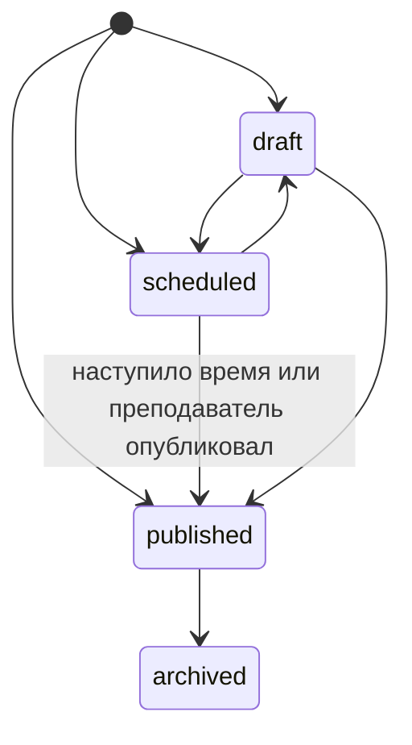
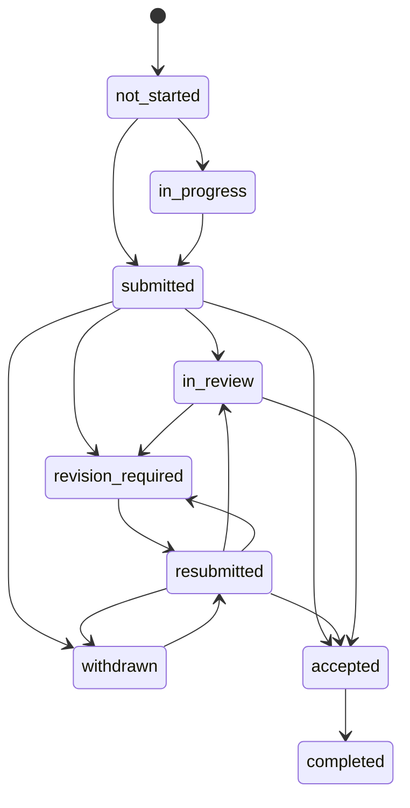

# Выдача, сдача и проверка учебных работ

## Студенту

1. Откройте **Учебные материалы и задания → Сдача работ** или перейдите по уведомлению. В карточке есть дисциплина, условия, критерии, материалы и срок по Москве. Кнопка **Отметить начало работы** переводит задание в состояние **В работе**. Отметка личного плана доступна отдельно.
2. Отправьте результат одним или несколькими разрешёнными способами. Длина текста от 10 до 8000 символов. Ссылки используют HTTPS. При разрешённой загрузке можно приложить до трёх файлов на 1 МиБ суммарно. Для работы, не требующей вложения, преподаватель может разрешить отметку **Работа выполнена**. Черновик текстовых полей сохраняется в кабинете. При повторном открытии формы файлы нужно выбрать заново.
3. Получив уведомление о доработке, откройте карточку, прочитайте замечания и отправьте новую версию. Проверьте действующий срок и доступные попытки. В **Истории версий** хранятся даты, содержимое, вложения и результаты проверки. Комментарии также собраны в блоке **Обратная связь преподавателя**.
4. Принятая работа и начисленные баллы появятся в **Успеваемости и посещаемости**. Если работа сдана после срока, история сохраняет отметку об опоздании.

## Преподавателю

1. Откройте **Группы и дисциплины → нужная дисциплина и группа → Задания**. Выберите **Создать задание** и заполните заголовок, условия, описание, критерии и допустимые способы сдачи. В настройках можно привязать занятие, добавить до пяти ссылок на материалы, указать конкретных получателей, назначить ответственного за общую сдачу и выбрать правило распределения баллов.
2. Выберите черновик, публикацию сейчас или публикацию по расписанию. Черновик можно сохранить с одним названием. Запланированная работа становится доступной в назначенный момент. У опубликованного задания можно изменить текст, сроки, материалы, критерии, способы сдачи и правила повторов. Состав участников, правило начисления, максимальный балл, вид работы и связь с занятием фиксируются при публикации.
3. Откройте работу из уведомления или списка. Фильтры позволяют выбрать статус проверки, студента и отправки с опозданием. Просмотрите ответ, файлы и предыдущие попытки.
4. Нажмите **Взять на проверку**, **Вернуть на доработку** или **Принять работу**. Для доработки нужен комментарий. Можно сразу продлить срок. **Дать обратную связь** сохраняет комментарий и при необходимости оценку для обсуждения. **Принять работу** фиксирует результат и начисляет указанный балл. **Завершить** закрывает принятую работу.
5. Чтобы изменить срок одного получателя, используйте **Продлить срок**. Для команды срок меняется у всех её участников. Архивирование закрывает новые отправки и проверки. Ранее доступные данные и вложения остаются в истории.

## Модель и состояния

Основные связи сохраняются: назначение преподавателя `TeachingLoad` → задание `GroupWork` → адресная выдача `WorkDelivery` → личная запись срока `Deadline`. `AssignmentSubmission` держит текущее состояние, ревизию и ключ последней отправленной версии. `SubmissionAttempt` сохраняет независимый снимок ответа, номера попытки, времени, признака опоздания и участника, отправившего работу. Бинарные вложения связаны с неизменяемой попыткой и резервируются вместе с БД. `WorkFeedback` связывает действия преподавателя с конкретной версией. Журнал `workspace_operation_events` сохраняет операции без копирования содержимого вложений.

Поддерживаются домашние, лабораторные, практические, контрольные, самостоятельные, проектные, курсовые, индивидуальные и групповые работы, реферат, доклад и пользовательский тип. Групповой тип требует назначить ответственного. Правила сдачи задаются общей формой и действуют для всех типов.

Даты и время проверяются сервером. Ввод в кабинете преподавателя идёт по Москве, API принимает дату и время с явным смещением. Сроки старых записей без времени истекают в 23:59:59 по Москве. Индивидуальное продление должно быть позже действующего срока. Доставка следующей версии требует отзыва или возврата на доработку. Для старых личных записей без карточки преподавателя сохраняется возможность повторной отправки и прежняя совместимость API. Ограничение попыток действует на сервере. Если собственный лимит отсутствует, технический максимум составляет 50 попыток.

При принятии создаётся положительное начисление в реестре успеваемости в той же транзакции. Источник — ID задания. Для команды выдаётся одно начисление на назначенного получателя по выбранному правилу **Всем участникам** или **Только ответственному**. Нулевая оценка фиксирует результат проверки без движения баллов. Комментарии, пропуски, просрочки, архивирование и повтор запроса не уменьшают накопленный результат. Показанная в старом отзыве оценка остаётся частью истории.

## Доступ, повторы и уведомления

Студент получает записи по своей сессии и адресной выдаче. В общей работе прикреплённые материалы и попытки видят участники, по-прежнему состоящие в той же разрешённой группе. Отправляет и отзывает работу ответственный. Преподаватель читает и изменяет работы только своей дисциплины и группы. Получатель после перевода сохраняет доступ к собственным ранее сохранённым данным, при этом новая отправка на старую нагрузку и доступ к общей отправке закрываются. Вложения выдаются отдельным авторизованным API с принудительной загрузкой и без кэширования.

Публикация, изменение условий и срока, напоминания о сроке и просрочке, отправка преподавателю, возврат, принятие и начисление баллов создают адресные уведомления со ссылкой на работу. Напоминания проверяются при обращении кабинета студента. Сервер сверяет версии и сериализует изменения. `Idempotency-Key` возвращает уже сохранённый ответ для того же запроса. Повторное принятие с другим ключом отклоняется по состоянию. Предметный максимум проверяется при начислении.

| Маршрут | Назначение |
|---|---|
| `GET /api/learning/assignments` | Работы студента. Параметры `offset`, `start`, `end` для страницы или периода. |
| `GET /api/learning/assignments/{deadline}` | Условия, состояние, отзывы и версии. |
| `POST …/{deadline}/start`, `/submit`, `/withdraw` | Начало, сдача, отзыв своей или общей работы. |
| `GET …/{deadline}/files/{file}` | Скачать вложение с проверкой адресной выдачи. |
| `GET/POST /api/teaching/{load}/works` | Список работ и создание. |
| `GET/PATCH …/works/{work}` | Работа, получатели, отправки, редактирование или архив. |
| `PATCH …/works/{work}/recipients/{student}` | Индивидуальное или командное продление. |
| `POST …/works/{work}/feedback/{submission}` | `review`, `revise`, `accept`, `complete`, `comment`. |
| `GET …/works/{work}/submissions/{submission}/files/{file}` | Скачать файл для проверки. |

Ошибки `404` обозначают недоступную запись. `409` возвращается при устаревшей версии, неподходящем состоянии или исчерпанных попытках. `422` указывает на ошибку входных данных, времени, формата или баллов. Внешние ссылки открываются в отдельной вкладке, а сервер их содержимое не загружает. Сервер принимает только расширения PDF, TXT, MD, CSV, PNG, JPG, JPEG, DOCX, XLSX и PPTX. Содержимое выдаётся на скачивание. Для отдельных команд преподаватель создаёт карточки с их составом; общая отправка внутри одной карточки принадлежит одной команде.

Миграция `0014_assignment_workflow` добавляет поля и таблицы, не меняя ID прежних работ, сроков, отправок и отзывов. Последнее сохранившееся содержимое старой отправки переносится в историю одной попыткой. Если прежний код уже перезаписал отправку, её старое содержимое восстановить из текущей БД нельзя. Для старых записей без точного времени сдачи отметка опоздания не реконструируется. Требуется штатная резервная копия БД и запуск `python -m app.db migrate` до открытия новой версии.
