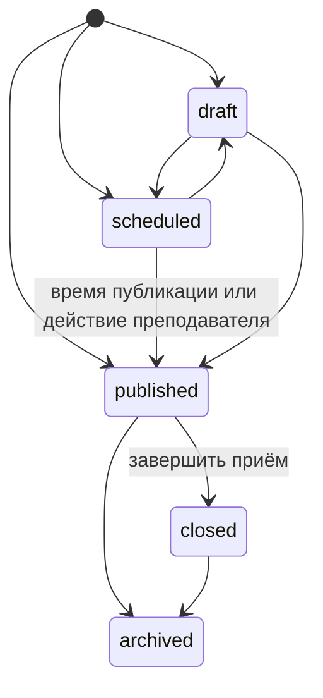
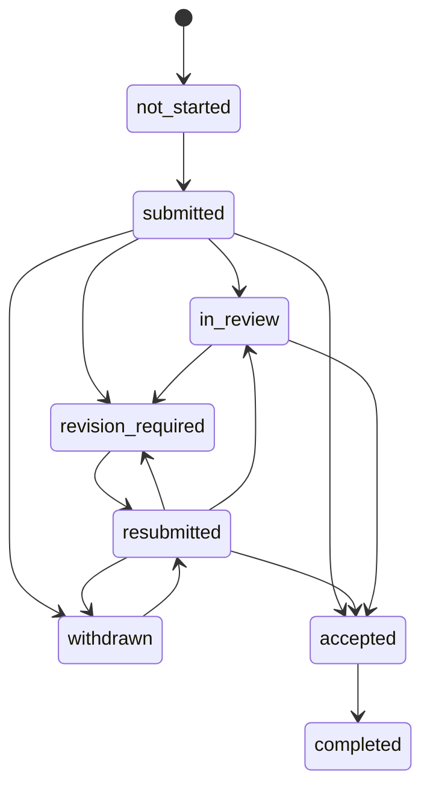

# Сдача работ

## Студенту

В разделе **Учебные материалы и задания → Сдача работ** задания сгруппированы по дисциплинам. Ближайшие сроки показаны над списком. Фильтры открывают несданные, отправленные, возвращённые на доработку и проверенные работы. Прежние ссылки на конкретные задания ведут к той же записи.

В форме **Сдать работу** после названия, срока и статуса идут поля ответа. Преподаватель выбирает допустимые и обязательные способы. Для заданий с файлами форма показывает нужное количество и форматы. Для задания только с файлами достаточно приложить файлы. Условие, критерии, файлы преподавателя и ссылки на материалы открываются ниже формы.

Текст, ссылка и выбранные файлы сохраняются как черновик в браузере, отдельно для каждого аккаунта и задания. Откройте работу в том же браузере, чтобы продолжить. При ошибке связи можно повторить отправку. Если сервер успел сохранить попытку, повтор с тем же ключом возвращает результат этой попытки.

В работе, возвращённой на доработку, доступны замечания, приложенные исправления и действующий срок. Каждая отправка получает свой номер. История показывает ответ, дату, вложения и действия преподавателя для каждой версии. Начисленные баллы и корректировки отражаются в **Успеваемости и посещаемости**.

## Преподавателю

1. Откройте **Группы и дисциплины → нужная дисциплина и группа → Сдача работ**. Создайте задание для всей группы, учебной подгруппы или выбранных студентов. Для совместной сдачи можно назначить ответственного и выбрать, кому начислять баллы.
2. Выберите тип задания, заполните условие, критерии и общий срок. Доступны лабораторные, практические, домашние, контрольные, самостоятельные, проектные, курсовые, индивидуальные и групповые работы, реферат, доклад и свой тип. Исходники можно загрузить в задание или связать с материалами дисциплины. Укажите, допустима ли поздняя сдача и сколько попыток доступно.
3. Выберите черновик, публикацию сейчас или публикацию по расписанию. Состав получателей фиксируется при выдаче. У опубликованного задания можно менять условие, критерии, материалы, общий срок и правила сдачи. Индивидуальный срок можно назначить, сбросить до общего или отдельно продлить действующий срок. Для совместной работы срок общий для участников.
4. Откройте отправку из списка или уведомления. Выберите **Взять на проверку**, **Дать обратную связь**, **Вернуть на доработку** или **Принять работу**. Для возврата укажите пояснение и при необходимости назначьте срок пересдачи. К отзыву можно прикрепить исправления. Две попытки можно выбрать в окне сравнения.
5. Балл можно выставить при принятии или добавить к уже принятой работе отдельным действием **Оценить работу**. **Завершить проверку** закрывает проверку принятой работы. Для исправления опубликованной оценки используйте **Скорректировать балл** и укажите причину. Действие доступно и в архиве для преподавателя, которому сейчас назначена эта нагрузка.
6. **Закрыть приём** закрывает новые отправки. Уже сданные работы можно проверить, принять и оценить. **В архив** закрывает приём и обычную проверку. Студенты и преподаватели с доступом могут открыть прежние версии и скачать связанные с ними вложения.

## Сроки и состояния

В кабинете ввод и показ сроков идут по Москве, UTC+3. API принимает дату и время со смещением. В БД сроки представлены однозначными моментами времени, ответы API используют UTC. Записи с датой без времени истекают в 23:59:59 МСК.

Действующий срок первой сдачи берётся из индивидуального срока, если он задан, или общего срока. Продление сдвигает его вперёд. Новый индивидуальный срок заменяет прежнее персональное правило и его продление. При возврате назначенный срок доработки имеет приоритет. Продление действующего срока в этом случае сдвигает срок доработки. Выбранная преподавателем политика поздней сдачи действует и при пересдаче. Время отправленной версии и её отметка об опоздании хранятся в истории.

В API результат сдачи представлен полем `status`. Просрочка рассчитывается по `deadline_passed`, а приём показывает `submission_window` со значениями `open`, `late` или `closed`. Возможность действий конкретного получателя отражают `can_submit` и `can_withdraw`. Официальная оценка представлена отдельным полем `score`, включая ноль. Ранее созданные записи `in_progress` показываются как несданные.

## Хранение, права и уведомления

Задание связано с назначением преподавателя `TeachingLoad`. Адресная выдача `WorkDelivery` связывает задание `GroupWork` со сроком `Deadline`. `AssignmentSubmission` хранит ревизию текущей сдачи. `SubmissionAttempt` и `WorkFeedback` сохраняют содержимое и проверку по версиям. Исходники привязаны к заданию, файлы студента к попытке, файлы проверки к конкретному отзыву. Данные и вложения включаются в резервную копию БД.

Каждый комплект файлов ограничен тремя файлами и 1 МиБ суммарно. Поддерживаются PDF, TXT, MD, CSV, PNG, JPG, JPEG, DOCX, XLSX и PPTX. Для файлов студента преподаватель выбирает подмножество форматов и количество. Ссылки используют HTTPS. Текстовый ответ при выборе этого способа содержит от 10 до 8000 символов. Для уже выданных работ с подтверждением выполнения сохраняется ранее выбранный способ сдачи.

Сервер проверяет сессию и адресную выдачу для студента, нагрузку и принадлежность работы для преподавателя. Совместную отправку повторно проверяют по текущей группе обоих участников. Скачать вложение можно по ссылке с проверкой доступа к его заданию и версии. Файлы выдаются как загрузка с приватным ответом без кэширования.

Публикация, существенное изменение условий, индивидуальный срок, сдача, отзыв преподавателя и корректировка оценки создают записи в уведомлениях кабинета. Напоминание о приближении срока и запланированная публикация появляются при синхронизации уведомлений. Напоминания учитывают настройки студента. Ключ события, транзакция и ключ повтора защищают от дублирования при повторных запросах. Смена состояния, сроки и результаты проверки фиксируются в журнале с автором и временем.

Реестр начислений хранит положительные баллы с источником задания. Нулевая оценка сохраняет результат проверки. Корректировка отдельной записью фиксирует старый балл, новый балл, автора и причину. Итог обновляется на разницу баллов конкретной работы в той же транзакции. Исходное начисление и прежние отзывы доступны в истории.

## API

| Маршрут | Назначение |
|---|---|
| `GET /api/learning/assignments` и `/api/learning/assignments/{deadline}` | Список, состояние, сроки, оценка и история. Список поддерживает `offset`, `start`, `end`. |
| `POST /api/learning/assignments/{deadline}/submit` и `.../withdraw` | Версия результата и отзыв до начала проверки. Отправка передаёт `version`, а заголовок `Idempotency-Key` связывает повтор с исходной попыткой. |
| `GET /api/learning/assignments/{deadline}/files/{id}`, `.../source-files/{id}`, `.../feedback-files/{id}` | Скачивание файла результата, задания или отзыва. |
| `POST /api/teaching/{load}/works` и `PATCH .../works/{work}` | Выдача и редакция. `subgroup_id` или `recipient_ids` задают адресную выдачу. `methods`, `required_methods`, `min_files` и `max_files` задают форму. Новые исходники передаются в `source_files`, удаляемые ID в `remove_source_ids`. |
| `PATCH /api/teaching/{load}/works/{work}/recipients/{student}` | Изменяет `individual_due_at` либо продлевает через `extended_until`, с проверкой `version`. |
| `POST /api/teaching/{load}/works/{work}/feedback/{submission}` | Проверка версии. При возврате `extended_until` задаёт срок доработки. Дополнительные поля `remarks` и `files` сохраняются с отзывом. |
| `POST /api/teaching/{load}/works/{work}/submissions/{submission}/score-corrections` | Исправляет опубликованный `score`. Требует `reason`, `version` и `submitted_version`. |
| `GET /api/learning/progress` и `GET /api/teaching/{load}/points/{student}` | Реестр положительных начислений и массив `corrections` с изменениями. |

Схема `0020_assignment_deadlines` добавляет персональный срок и срок доработки. `0021_assignment_feedback` добавляет замечания и прежний балл к отзыву. Новые таблицы хранят исходники, файлы проверки и корректировки. Применяйте штатную резервную копию и `python -m app.db migrate` перед переключением версии. [Миграции](../migrations/README.md) · [Снимки из браузера](../screenshots/assignments-stage-5/README.md).
