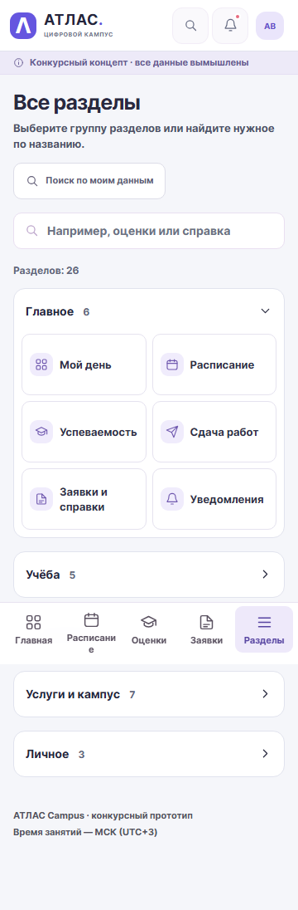
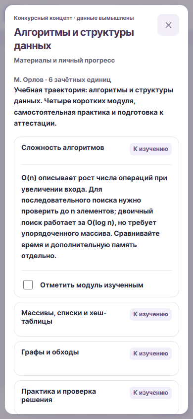
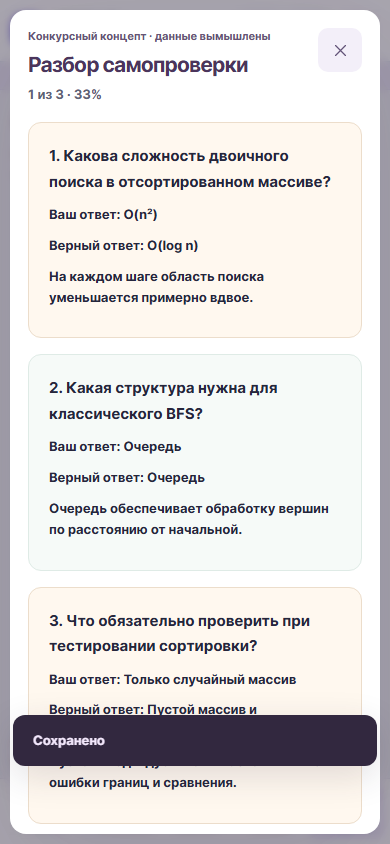
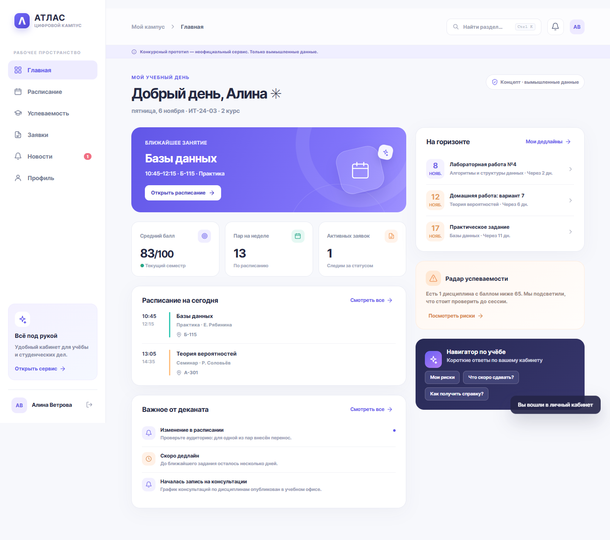
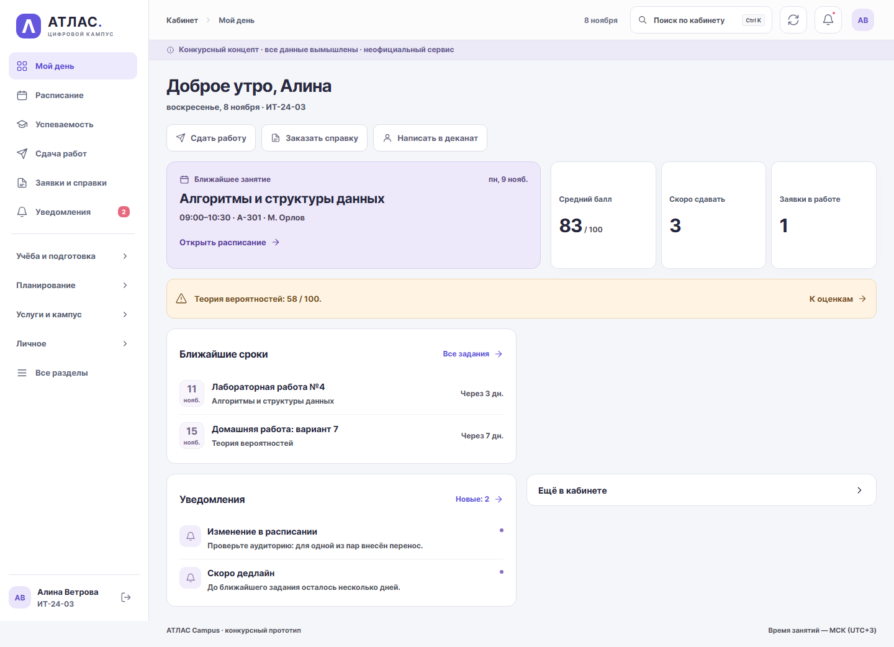
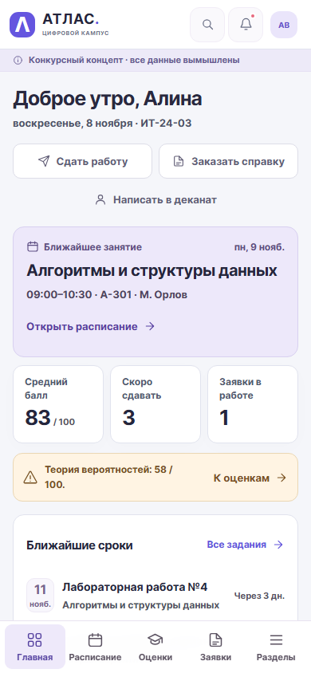
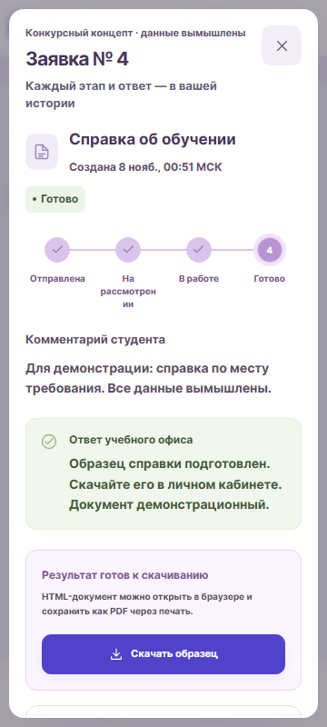

# АТЛАС Campus: расширение до версии 3.0

**7 ноября 2026.** Рабочий конкурсный концепт, все данные вымышлены. Актуальное приложение включает **27 студенческих разделов, 5 разделов сотрудника и 22 услуги**. [Каталог функций](../features.md) описывает более 80 конкретных действий и сохранение каждого. [Актуальный PDF со снимками](../ATLAS_Campus_3_Report.pdf) дополняет текст; прежний PDF относится к версии 2.0.

## Задача и выбор функций

Фактическая постановка пользователя: «Добавь как можно больше функционала (в соответствии с тз). не останавливайся на 5-10 добавлениях». До работы прочитаны полное приложенное ТЗ и AGENTS.md. Уже работавшее ядро сохранено; расширение добавляет связанные действия в учёбе, услугах и сопровождении.

Дисциплина связывается с материалами, сдачей, самопроверкой, сессией и консультацией. Переписка заканчивается ответом и уведомлением; книга — выдачей и возвратом; запись — контролем мест и отменой. Каталог «Всё» и группы навигации позволяют не помещать десятки кнопок в нижнее меню телефона. Выбор дополнительных сценариев — продуктовые гипотезы по ТЗ, а не результат выдуманных интервью.

## Фактическая работа ИИ

Основной Codex-ассистент отвечал за интерфейс, интеграцию, портфолио, поиск, управление сеансами, расширение услуг, миграцию, общую приёмку и отчёт. Три дочерних агента получили отдельные области по ролям AGENTS.md:

- Учебный Backend: новые модели, 32 учебных API, контракты до реализации UI, отрицательные тесты; затем реальный браузерный runner, axe и снимки.
- Сервисный Backend: консультации, переписка, события, библиотека, финансы, настройки и пульт; затем три реальных браузерных сценария и каталог функций.
- Security/QA: независимое внутри чата чтение кода, воспроизведения прав/CSRF/IDOR/конкуренции/перезапуска и два фактических браузерных дефекта; не редактировал проверяемый клиент.

Использованы Codex и его агенты, PowerShell/Python/Node, FastAPI/SQLAlchemy, pytest/HTTPX, Playwright/Chromium, axe-core, ReportLab/Pillow/Poppler. Для показа результата открыт локальный кабинет во встроенном браузере. Новые библиотеки приложения, внешний генеративный ИИ, e-mail, банк или реальные вузовские системы не подключались. Интервью, генеративные картинки и видео не создавались. Подтверждённый ручной вклад пользователя — цель, ТЗ и инструкции проекта; неподтверждённые ручные этапы ему не приписываются.

## Исправленные ошибки

1. SQLite терял offset timestamps и первые три часа московского дня: границы и сохраняемые моменты приведены к UTC, показ остаётся в МСК.
2. После сохранения самопроверки старый результат Алины мог открыться поверх кабинета Марка при задержанном обновлении. Повторная проверка поколения сеанса после обновления закрыла дефект; браузерная регрессия сначала падала, затем прошла.
3. Поздняя загрузка закрытого теста меняла подписи разбора другого теста. Проверены ID диалога и источник подписей из серверного ответа.
4. Формы и DTO имели несовпадающие enum/пределы, проценты и счётчики. Исправлено до финальной сквозной приёмки.
5. Подписи дней календаря не проходили контраст axe. Первый отчёт сохранён в истории, цвет затемнён, все ширины перепроверены.
6. Запуск `python -m app.db` создавал отдельный реестр моделей расширений. Реестр объединён; subprocess-тест проверяет migrate, seed дважды и повторный migrate.

[AI-log](../ai-log.md) содержит реальные выдержки поручений; [security-review расширения](../extension-security-review.md) — воспроизведения. Это ИИ-review внутри среды, не внешняя аттестация.

## Проверка и материалы

Полная suite — **122 passed**, без пропусков. Браузер расширения — 8 учебных сценариев и 128 посещений всех разделов на 360/390/768/1440 px, 132 измерения без горизонтального переполнения, 133 состояния axe без нарушающих узлов, 131 снимок. Ядро отдельно перепроверено: 13 сценариев, 40 измерений, 32 состояния axe. Все успешные API-ответы настоящие; рабочая БД не используется тестами. Отдельно сравнение рабочей базы с резервной копией подтвердило неизменность исходных данных восьми таблиц.

Локальный запуск и готовая упаковка описаны в README. Публичный адрес, доступ из России, реальный телефон и обязательство работы до 28 ноября ещё требуют внешнего этапа. Инфраструктурная приёмка PostgreSQL/TLS от 6 ноября относится к версии 2.0 и не выдаётся за приёмку новых модулей.

Далее сохранён исторический процесс версии 2.0 от 6 ноября, включая инструменты и проверки той итерации.

---

# АТЛАС Campus: процесс создания версии 2.0

**Дата:** 6 ноября 2026. **Статус:** отчёт о фактической доработке предоставленного локального прототипа. **Все данные вымышлены.** Концепт не связан с настоящим вузом, его логотипом, учётными записями или системами.

## 1. Задача и границы

Основание — предоставленное капитаном ТЗ «Цифровой деканат будущего»: вход/профиль, расписание, успеваемость, заявки/справки и уведомления; работа от 360 px, сохранение, защита чужих данных и понятный статус конкурсного концепта. Дополнительная задача этой итерации — существенно продвинуть проект до полноценного локального рабочего стенда с лёгким переносом в облако.

На старте уже существовали пять основных разделов, два студента, роль сотрудника, API и ранние тесты. Поэтому работа была направлена на завершённость сценариев, а не замену названия и нескольких цветов. Публичная публикация сейчас не запрашивалась; её требования перечислены отдельно перед конкурсной отправкой.

## 2. Проблема и выбор сценариев

ТЗ описывает разрозненные источники расписания, оценок, документов и объявлений. Из этого выведены пять проверяемых продуктовых гипотез: студенту нужно быстро узнать ближайшую пару, не пропустить изменение, понять учебные риски, видеть свои сроки и получить документ с понятным результатом.

Интервью с реальными студентами не проводились, статистика спроса не собиралась. Ответы и участники не выдумывались. [research.md](../research.md) связывает гипотезы со сценариями и содержит план добровольного анонимного исследования.

Основной продуктовый путь: **увидеть дело → выполнить действие → получить подтверждение → вернуться к сохранённому результату**. Для справки это означает подачу, номер, историю, ответ учебного офиса, уведомление и скачивание конкурсного образца. Для учебного плана — завершение задания и сохранение отметки после перезагрузки.

## 3. Внутренняя шкала качества

Четыре критерия конкурса разложены на 40 наблюдаемых признаков: 10 на идею, использование ИИ, имплементацию и качество. Рубрика использовалась для выбора работ и их приёмки. Это собственный инструмент проверки, а не официальная оценка экспертов и не обещание 40/40.

Существенные изменения: завершённый workflow документа; серверные действия учебного плана; календарный экспорт; точное ближайшее занятие; очередь с поиском/страницами; независимые агентные проверки; настоящие browser/DB/HTTPS-тесты; проверенный backup/restore. Подробно: [jury-rubric.md](../jury-rubric.md).

## 4. Фактически использованные инструменты

| Инструмент | Для чего использован |
|---|---|
| Codex в настольном приложении, основной ИИ-ассистент | Анализ ТЗ, продуктовая декомпозиция, интерфейс, интеграция, проверки, отчёт и упаковка |
| Три дочерних ИИ-агента в том же чате | Backend; отдельное Security/QA review; QA/Release. Backend затем выполнил документальное поручение Product researcher |
| AGENTS.md | Карта проекта, инварианты защиты/данных/ширины и явно заданные агентные роли |
| Навык Sites | Применён к локальному workflow сайта; регистрация и публикация через Sites не выполнялись |
| Навык PDF | Создание отчёта, рендер страниц и визуальная проверка |
| PowerShell, Python, Git CLI, Node.js | Чтение файлов, разработка, проверки синтаксиса и запуск инструментов; Git подтвердил отсутствие репозитория |
| FastAPI, SQLAlchemy, Pydantic, Argon2, Psycopg, Uvicorn | Рабочий API, хранилище, права, валидация и вход |
| Pytest и HTTPX | Положительные, отрицательные, конкурентные и межпроцессные проверки |
| Playwright и Chromium | Реальный локальный браузер: сценарии, размеры, загрузки, ошибки, фокус и скриншоты |
| axe-core 4.14.0 через npm | Проверки доступности только в среде разработки, без добавления к сайту |
| Docker Engine/Compose, PostgreSQL и Caddy | Реальный переносимый стенд, TLS, перезапуск, два worker-процесса, backup/restore |
| PyPA pip-audit, базы PyPI и OSV | Известные advisory полного инвентаря Linux-контейнера; сканер в отдельной временной среде |
| Веб-поиск и официальные upstream-источники | Проверка исправленных версий базовых образов и правил accessibility; не сбор пользовательских данных |
| ReportLab, Pillow, Poppler и PDF-инструменты | Сборка, рендер и проверка итогового документа |

Другие ИИ-модели/IDE, генераторы картинок, реальный вуз, Supabase, SSO и внешняя генеративная модель к приложению в этой итерации не подключались. Собственная иллюстрация — CSS/SVG. Полный состав прямых библиотек и лицензий: [third-party.md](../third-party.md).

## 5. Постановки задач и согласование агентов

Первый фактический пользовательский запрос этой итерации начинался: «нужно улучшить проект в соответствии с тз. не останаливайся на нескольких точечных улучшениях». К нему были приложены полное ТЗ и инструкции AGENTS.md. Требование о локальном запуске и простом переносе в облако сохранено.

Основной агент прочитал ТЗ и исходники, зафиксировал недостающие законченные пути и выдал три поручения по ролям из AGENTS.md. Владение файлами разделено: Backend — `app` и API-тесты; Security — отдельные тесты и отчёт; Release — контейнеры, запуск, эксплуатация и CI; основной агент — UI, интеграция, browser-приёмка и итоговые материалы.

До реализации интерфейса Backend прислал точные контракты: история/версия/срок/ответ заявки, идемпотентность, завершение задания, ICS и `next_lesson`. Затем отдельная находка Security привела к серверной пагинации, поиску и счётчикам. Это реальные согласования в текущем чате, а не список будущих воображаемых ролей.

Выдержки из фактических поручений и сообщения об ошибках сведены в [ai-log.md](../ai-log.md). Скриншоты чата не создавались и не подделывались. Текст отчёта не заявляет, что он заменяет исходную историю переписки.

## 6. Итерации и ошибки

1. **Исходные проверки были слабее сценария.** В старой документации UI был проверен с подменой API; новый runner запускает отдельный настоящий HTTP-сервер и браузер. Подмены успешных ответов нет.
2. **Ограничения CSP обнаружили inline-стили.** Новый клиент вынес оформление в CSS, сохранив строгую политику скриптов и стилей.
3. **Запоздалый ответ при смене аккаунта.** Security выявил возможность вывести ответ навигатора прежнего студента. Добавлено поколение сеанса и игнорирование старых ответов/401. Настоящий браузерный тест меняет Алину на Марка до доставки ответа.
4. **Хранилище браузера недоступно.** Успешная заявка могла ошибочно показаться неуспешной из-за удаления черновика. Удаление из storage безопасно; черновик и ключ повторной отправки остаются в памяти вкладки даже после закрытия/повторного открытия формы. При запрете storage интерфейс предупреждает, что перезагрузка вкладки удалит такой черновик. Браузерный тест обрывает уже сохранённый ответ, закрывает форму, открывает снова, повторяет и подтверждает одну запись.
5. **Список из последних 200 скрывал старую активную заявку.** Фильтр перенесён в SQL до ограничения страницы, добавлены страницы и глобальные счётчики. Тест создаёт 210 закрытых заявок поверх старой активной.
6. **Конфигурация могла ошибочно ослабнуть.** Добавлены известные значения APP_ENV, декодирование пароля перед проверкой длины, строгие host/origin/HTTPS и явный режим демо в production.
7. **Первый новый browser-runner прошёл сценарии, но не очистил временную БД Windows.** Исправлены закрытие sqlite-соединения и остановка только собственного дерева процессов. Финальный runner завершился успешно.
8. **Первый accessibility-проход нашёл светлый текст и неточные подписи.** Цвета проверены на фактических фонах; исправлены доступные имена, роли и подписи. Проверка расширена на выполненное задание, поиск, ошибку и готовый документ; итог — 32 состояния без обнаруженных нарушений выбранных правил.
9. **Сборка Docker временно встретила ошибку DNS PyPI.** Не добавлялись постоянные IP или отключение TLS. Финальная обычная сборка прошла; в отчёте сохранено различие между временной проблемой сети и результатом приёмки.
10. **Аудит зависимостей нашёл реальные upstream-advisory.** Обнаружены пять уникальных уязвимостей исходной Starlette 0.50.0. Исправление потребовало совместимого обновления FastAPI до 0.133.0 и Starlette до 1.3.1. Полный инвентарь нового контейнера проверен PyPI и OSV: 0 известных находок без исключений. Linux-версии закреплены в runtime lock; подробности и границы — [dependency-review.md](../dependency-review.md).
11. **Отложенный автофокус мог перехватить первый Tab.** При повторном открытии формы браузерная проверка выявила гонку с requestAnimationFrame. Фокус устанавливается синхронно после вставки диалога в DOM; проверка Tab/Escape пройдена без ослабления утверждений.

Все пункты описывают фактические находки этой итерации. Review дочернего агента — отдельное поручение внутри той же ИИ-среды, а не внешний сертификационный аудит.

## 7. Как устроены вход и защита

Пароль сохраняется только как Argon2id-хеш. После входа браузер получает случайный токен в HttpOnly cookie, а база — его хеш. В production cookie передаётся только по HTTPS. Сервер сам узнаёт владельца и роль из сеанса, а не доверяет `student_id` из браузера.

Каждый личный запрос выбирает данные только вошедшего студента. Чужой ID не раскрывает существование/содержимое заявки или документа. Сотрудник меняет только допустимые этапы; готовность и отклонение требуют понятного ответа. Изменение, история и уведомление сохраняются транзакционно. Версия защищает от перезаписи другим сотрудником, а ключ отправки — от дубликатов.

Вход ограничивается общей SQL-квотой, которая переживает новый процесс. Origin, CSRF-заголовок, размер запроса, CSP и безопасное экранирование проверяются тестами. Никаких ключей ИИ, реальных логинов, вузовских интеграций или настоящей юридической подписи нет. Образец документа содержит явное предупреждение и не имеет юридической силы.

## 8. Что проверено

- `node --check static/app.js` — успешно.
- Все pytest с включёнными Chromium-регрессиями — **68 passed**, два предупреждения тестовых зависимостей: TestClient/httpx и alias Starlette/AnyIO.
- Реальный Chromium/HTTP: **13 групп сценариев**, **40 измерений геометрии**, **45 актуальных снимков** на 360/390/768/1440 px; JavaScript/CSP-ошибок не обнаружено.
- axe-core: **32 состояния** на 1440 и 360 px, **0 обнаруженных нарушений** выбранных автоматических правил. Это не сертификация WCAG и не проверка скринридером.
- Настоящий PostgreSQL 17.11, Python 3.13.18 и Caddy 2.11.9: HTTPS с проверкой локального сертификата, роли, два процесса, миграции, перезапуск и восстановление backup. После восстановления совпали 8 заявок и 23 события.

Первичные результаты находятся в `docs/verification`, методика и ограничения — в [release-checklist](../release-checklist.md). Тесты используют временные/изолированные вымышленные базы, не сбрасывают рабочие заявки.

## 9. Скриншоты до/после

Текущие снимки получены в настоящем локальном приложении. `before-2026-11-06` снят с сохранёнными исходными JS/CSS и исходным реальным локальным API. Это не публичный домен и не физический телефон. [screenshots/README](../../screenshots/README.md) объясняет происхождение и полностраничную съёмку.

## 10. Ручная работа и отправка

Подтверждённый вклад пользователя в этом чате — постановка цели, предоставление ТЗ и AGENTS.md. Код, проверки, снимки и этот отчёт выполнялись ассистентом и его агентами через инструменты. Не подтверждённые интервью, ручное рисование, загрузка кода, размещение сайта или запись видео капитану не приписываются.

Подготовлены локальный запуск одним файлом, чистая упаковка, инструкции VPS, HTTPS, миграции, мониторинг и проверенное резервирование. Для конкурсной отправки капитану остаются внешний домен/хостинг, проверка из России, доступный жюри репозиторий/архив, обеспечение работы до 28 ноября и фактические материалы ручных шагов. Сценарий видео до пяти минут подготовлен, само видео не записано.

Это завершённый локальный конкурсный прототип с проверенным путём переноса. Приёмка реального вуза и обработка настоящих персональных данных — отдельная задача за пределами ТЗ с вымышленными данными.

## 11. Версия 3.1: удобство, 8 ноября 2026

Пользователь попросил существенно повысить интуитивность и уменьшить прокрутку без потери читаемости, удалить помощников. Полное приложенное ТЗ прочитано до изменений. Основной ассистент переработал навигацию, главную, списки и формы; внутренний UX/Visual review прошёл до и после по исходникам и настоящим снимкам. Второе поручение проверило защиту, удалило помощника и исправило контракт точного поиска. Это два реальных отдельных поручения в одной ИИ-среде, не внешние эксперты и не интервью.

Обнаруженные ошибки не скрывались: новый CSS первоначально не входил в серверный allowlist; логотип получил неточное доступное имя; закрытые модульные чекбоксы ошибочно учитывались в Tab-цикле; запоздавшая заявка могла заменить новый поиск. После воспроизведения изменены owning source и соответствующие регрессии. Старые browser-пути адаптированы к настоящему раскрытию меню и новым фильтрам без force-click и без удаления проверок безопасности.

Первоначальные значения данных и пять сценариев конкурсного ядра сохранены. Мобильные страницы стали компактнее за счёт групп, дневного вида и раскрытия подробностей, текст вырос. Проценты измерены автоматически на одинаковых вымышленных начальных данных и не выдаются за исследование с реальными пользователями. Помощник «Подскажет АТЛАС» и серверный маршрут удалены.

Актуальные сравнения, снимки и границы — [отчёт 3.1](../usability-2026-11-08.md), результаты — [приёмка](../release-checklist.md). Прежние PDF и разделы процесса выше относятся к указанным в них прошлым версиям. Нового публичного размещения, физического телефона, российского соединения и записи видео в этой итерации не было.
