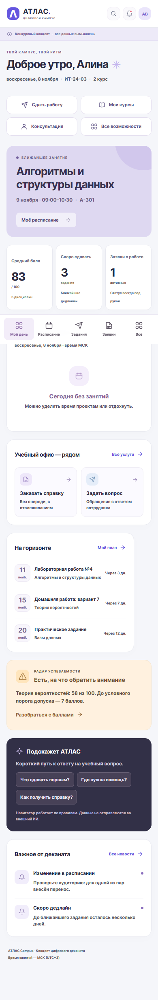
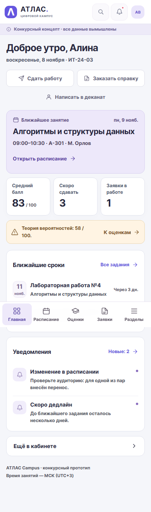
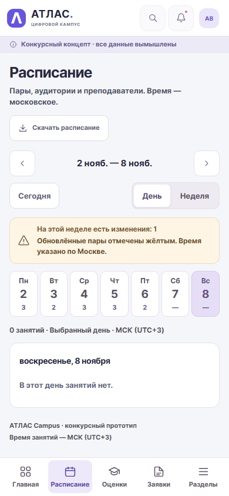
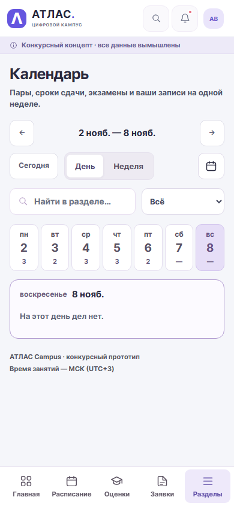

# ATLAS Campus 3.1: понятнее и компактнее

8 ноября 2026. Конкурсный концепт, все данные вымышлены. Работа выполнена в существующем локальном Python-приложении; сайт не публиковался.

Пользователь попросил существенно улучшить понятность интерфейса по конкурсному ТЗ, сократить прокрутку без потери читаемости и удалить существующих ИИ-помощников. Приложенный полный текст ТЗ прочитан до изменения исходников.

## Что изменилось

| Область | Новое поведение |
|---|---|
| Основная навигация | Постоянно видны главная, расписание, оценки, сдача работ, заявки и уведомления. Остальные пункты собраны в раскрываемые группы; группа текущего раздела открывается автоматически |
| Телефон | Внизу пять понятных направлений: «Главная», «Расписание», «Оценки», «Заявки», «Разделы». Последний пункт остаётся активным во вложенных разделах |
| Все разделы | «Главное» открыто сразу, прочие группы раскрываются по необходимости. Поиск понимает привычные названия и автоматически показывает подходящие группы |
| Главная | Ближайшая пара, два ближайших срока, оценки и статус заявок. Убраны крупная декоративная иллюстрация, повторные услуги и пустая карточка расписания. Дополнительные ссылки находятся под раскрытием |
| Заявки | Сначала «Мои заявки», затем отдельный каталог услуг. Поиск проверяет все категории; статусы и готовый результат не нужно искать после длинного каталога |
| Карточка заявки | Ответ и результат видны раньше истории. Сотрудник видит решение и форму ответа до свёрнутой истории; допустимые переходы и проверка версии сохранены |
| Расписание | На телефоне сразу открывается день. Полоса дней показывает число занятий, недельный вид сохранён. Счётчик относится к выбранному виду; пустое состояние не называет произвольный день сегодняшним |
| Успеваемость | Читаемые строки оценок и компактные показатели. Предупреждение короче, даты сессии раскрываются. Переход к учебным материалам ведёт к дисциплинам |
| Дисциплины | Вместо высоких плиток — название, преподаватель, зачётные единицы, прогресс и открытие курса. Модули внутри курса закрыты до выбора; подпись «Изучено» обновляется сразу после сохранения |
| Сдача работ | Сначала задания к сдаче; отправленные — в отдельном фильтре. Инструкция и полный ответ открываются в форме. Пересдача и отзыв сохранены |
| Мой план и задачи | Учебная отметка явно отделена от сдачи работы и собственных дел. Личные задачи, конспекты и диалоги представлены компактными строками |
| Календарь | На телефоне день, на широком экране неделя. Тип события выбирается в одном списке, произвольная дата — под кнопкой. Сохранены переходы между неделями и поиск |
| Подготовка | Сводка посещаемости по предметам, калькулятор баллов и история тестов раскрываются по запросу. Таймер расположен раньше журнала; выбор 5/15/25/45 минут сразу меняет его показания |
| Консультации и библиотека | Пустые личные списки не отодвигают каталог. Недоступная запись объяснена словами «Мест нет», «Запись закрыта» или «Все экземпляры выданы» |
| События и портфолио | Ключевая информация и действие остаются видимыми; длинные описания раскрываются. Сохранены регистрация, отмена и выгрузка своего портфолио |
| Финансы и контакты | Суммы на телефоне показываются целиком. Справочник стал списком с кабинетом и часами приёма; демонстрационный адрес раскрывается отдельно |
| Профиль и настройки | В профиле сотрудника нет пустых студенческих полей. Подробности безопасности раскрываются, выход остаётся явным. Плотность интерфейса восстанавливается сразу при входе |
| Формы | Случайное закрытие изменённой формы вызывает выбор «Продолжить» / «Не сохранять». При сетевой ошибке введённый текст остаётся. Черновик заявки и безопасный повтор отправки сохранены |
| Чтение и доступность | Основной текст списков 14–16 px, вспомогательные подписи преимущественно 12–13 px. Уплотнение достигнуто порядком информации и раскрытием подробностей; клавиатура учитывает закрытые модули |

## Помощник удалён

Удалены карточка «Подскажет АТЛАС», состояние ответа, обработчик тем, стили, модель `AssistantQuestion` и `POST /api/navigator`. Маршрут возвращает 404 для гостя и всех трёх демоаккаунтов. Тест подтверждает отсутствие помощника и запросов к нему в браузере. Справочник, самопроверка и обычный поиск остаются самостоятельными функциями без внешней модели.

## Поиск ведёт к найденному

Поиск в шапке и Ctrl+K объединяют названия разделов, синонимы и собственные записи. Без ввода показаны только частые направления. Найденные заявка, конспект и портфолио открываются напрямую; нужная оценка или учебный дедлайн выделяется в списке. Старый фильтр или поисковая строка раздела не скрывают выбранную запись.

Исправлен прежний контракт: `Grade.id` теперь ведёт к `grades`, а `Deadline.id` — к `plan`. Для точного уведомления добавлен `GET /api/notifications/{id}`: он не отмечает сообщение прочитанным и выбирает владельца в SQL. Чужой ID возвращает 404, сотруднику доступ запрещён. Схема базы не менялась. [Контракты](api-contracts.md), [воспроизводимый review](ux-security-review-2026-11-08.md).

Поздние ответы поиска, списка записей и уведомлений проверяют сеанс, текущую страницу и открытый диалог. Найденная во время review гонка уведомления сначала воспроизведена падающим тестом, затем исправлена: старый ответ больше не подменяет новый поиск карточкой заявки.

## Измерения до и после

Настоящий Chromium, чистые временные базы с одинаковыми вымышленными начальными данными, ширина 390 px. Сравнивается высота `#page-content`, а не субъективная скорость выполнения задачи. Выбран первоначальный вид страницы: часть сокращения даёт дневной режим и свёрнутые подробности, которые по-прежнему доступны.

| Страница | До, px | После, px | Сокращение |
|---|---:|---:|---:|
| Главная | 2228 | 1108 | 50% |
| Заявки | 1900 | 838 | 56% |
| Расписание | 2422 | 625 | 74% |
| Все разделы | 3287 | 883 | 73% |
| Дисциплины | 2286 | 940 | 59% |
| Сдача работ | 2470 | 1111 | 55% |
| Календарь | 2377 | 496 | 79% |
| Фокус и время | 1390 | 952 | 32% |

Не каждая страница стала короче на каждом размере: широкая недельная повестка использует более читаемые колонки вместо прежних семи узких. Успех не измеряется одним процентом уменьшения. Интервью и исследование с реальными студентами в этой итерации не проводились; универсальная понятность реальным пользователям не объявляется доказанной.

Машинные результаты: [до](verification/ux-before-2026-11-08.json), [после](verification/ux-after-2026-11-08.json). Полные снимки: `screenshots/ux-before-2026-11-08/` и `screenshots/ux-after-2026-11-08/`. Обе серии охватывают 27 студенческих и 5 служебных страниц на 360/390/768/1440 px, плюс четыре экрана входа. Перед изменением сохранены исходные UI-файлы в `outputs/ux-before-2026-11-08/`.

## Как проверяли

- `node --check` для обоих клиентских файлов и pytest с включёнными настоящими Chromium-сценариями. Новые проверки охватывают поиск, точное открытие, устаревшие ответы, XSS, сохранение формы при ошибке, клавиатуру закрытых модулей, таймер и целые денежные суммы.
- Два разных студента и сотрудник: вход, свои данные, подача и обработка заявки, сохранение и скачивание результата. Реальные HTTP-ответы не подменяются выдуманными успешными данными; для ошибок запрос прерывается или настоящий ответ задерживается.
- Все 32 страницы на четырёх ширинах: загрузка, предупреждение о концепте, геометрия, снимок и axe-core. Отдельно — модальные формы, пустые ответы, ошибка сети и повторная попытка.
- Существующие проверки IDOR, CSRF, ролей, миграций, перезапуска, идемпотентной отправки и конкурентной записи сохранены. Все автоматические сценарии используют временные базы; рабочая база не очищалась.

Итог: **141 pytest без пропусков**,128 текущих состояний UX/axe,136 проверок расширенной приёмки и133 axe-состояния расширения — без найденных нарушений. Числа и ссылки: [приёмочный лист](release-checklist.md). Это локальные браузерные проверки и эмуляция ширины. Физический телефон, публичный домен, TLS и доступность из российского подключения в этой итерации не проверялись; размещение и работа до 28 ноября не заявляются.

## Фактический процесс ИИ

Использован Codex: основной ассистент изменял интерфейс и проводил приёмку, два отдельных внутренних поручения выполнили read-only UX review и проверку безопасности/узкое исправление контракта. Это не независимая внешняя сертификация. ИИ используется для разработки; помощника внутри кабинета больше нет.

Инструменты: локальные Python/FastAPI/SQLite, Playwright Chromium для реальных сценариев и снимков, pytest, axe-core, Node для проверки синтаксиса, PowerShell для запуска. Новых библиотек, картинок, внешних шрифтов или ИИ-сервисов в приложение не добавляли. Подтверждённая работа пользователя — постановка цели, ТЗ и AGENTS.md. Интервью, ручное тестирование пользователем и публикация ему не приписываются. [Журнал постановок и исправлений](ai-log.md).
